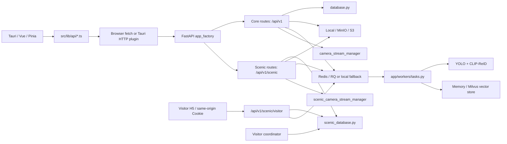
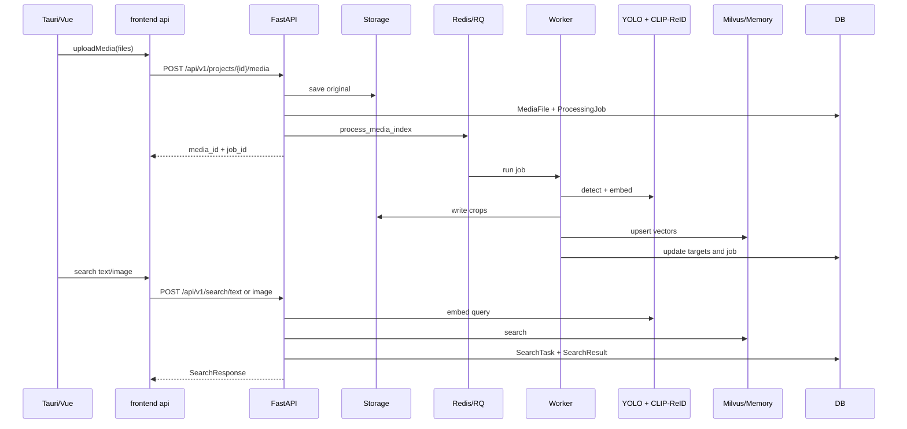
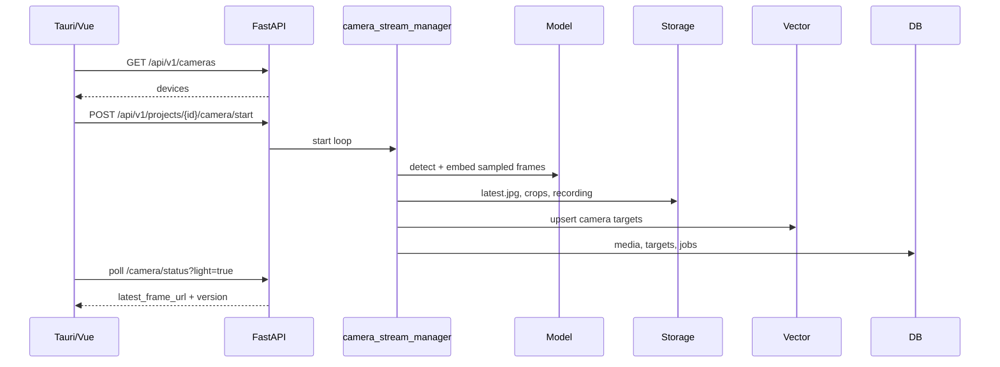
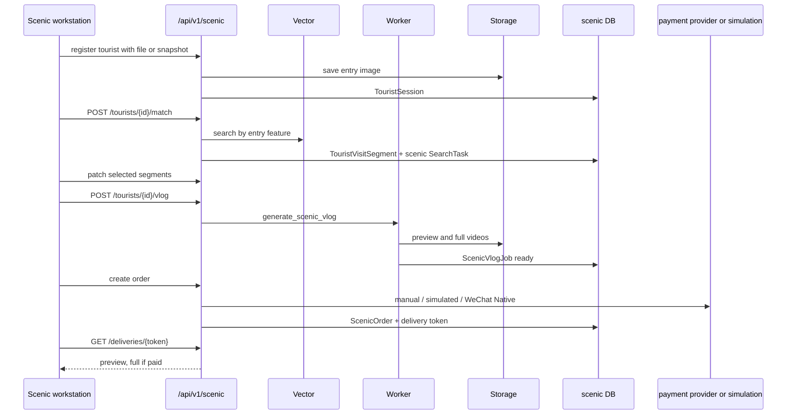

# MyReID API and Communication Guide / API 与通信机制

本文档记录 `allinone` 实际挂载的 HTTP API、两类前端封装和通信流程。后端默认 `http://127.0.0.1:2889`；本机 GPU 生产默认 `12889`，隔离游客测试默认 `22889`，完整配置见 [CONFIGURATION.md](CONFIGURATION.md)。

FastAPI 仍会提供默认交互式文档：

- Swagger UI: `/docs`
- ReDoc: `/redoc`
- OpenAPI JSON: `/openapi.json`

`python scripts/check_openapi_docs.py` 比较运行时 OpenAPI schema 与本文的 method/path 表；CI 对新增、删除或改名漂移失败。该检查不验证字段、权限说明和 WebSocket，后者仍需对照源码。

## 1. 架构总览



主要实现文件：

| 层 | 文件 | 说明 |
| --- | --- | --- |
| 应用入口 | `FastAPIBackend/main.py` | 兼容入口，导出 `app`。 |
| 应用工厂 | `FastAPIBackend/app/api/app_factory.py` | 创建 FastAPI app、注册中间件、挂载静态目录、include routers。 |
| 核心路由 | `FastAPIBackend/app/api/routes/*.py` | `/api/v1` 下的认证、项目、媒体、检索、指标等接口。 |
| 景区路由 | `FastAPIBackend/app/api/scenic/__init__.py` | 注册 auth/project/camera/tourist/vlog/order/editing/visitor 八组路由。 |
| 公共逻辑 | `app/api/auth_dependencies.py`、`app/services/`、`app/api/scenic/service_adapters.py` | 鉴权、RBAC、存储、检索等；`common.py` 与 `system_routes.py` 保留兼容/共享辅助，不是当前路由注册入口。 |
| 核心数据域 | `FastAPIBackend/database.py` | 核心 ReID 用户、项目、媒体、检索、审计。 |
| 景区数据域 | `FastAPIBackend/scenic_database.py` | 景区用户、项目、点位、游客、片段、Vlog、订单。 |
| Schema | `FastAPIBackend/app/schemas.py` | Pydantic 请求和响应模型。 |
| 前端 API | `TauriFrontend/src/lib/api/*.ts` | Tauri/Vue 对后端 API 的类型化封装。 |
| 前端状态 | `TauriFrontend/src/stores/workbench.ts` | 双工作台业务编排、轮询、错误和缓存状态。 |
| 游客前端 | `VisitorFrontend/src/shared/api.ts` | 同源 Cookie 请求、`X-Visitor-Request`、游客类型与错误解析。 |
| 游客制作 | `FastAPIBackend/app/workers/visitor.py` | 独立协调器，以 Scenic 库状态推进匹配与制作结果检查。 |

## 2. 协议基础

- Base URL: `http://127.0.0.1:2889`
- Core prefix: `/api/v1`
- Scenic prefix: `/api/v1/scenic`
- JSON 请求: `Content-Type: application/json`
- 文件上传: `multipart/form-data`
- 认证请求头: `Authorization: Bearer <access_token>`
- 游客私有接口: `myreid_visitor` HttpOnly Cookie；写请求 `X-Visitor-Request: 1`，来源与 `VISITOR_PUBLIC_BASE_URL` 匹配。
- refresh/logout 使用 refresh token 作为 bearer token。
- CSV 报告返回: `text/csv; charset=utf-8`
- Prometheus 指标: `GET /metrics`
- 请求追踪: 后端保留或生成 `X-Request-ID` 并写回响应头。

静态/媒体 URL：

- `/gallery/...`: 来自 `GALLERY_DIR`，用于头像和实时相机预览帧。
- `/objects/...`: 仅在 development/test 且 `OBJECT_STORAGE_MODE=local` 时挂载；生产与预发布不挂载对象目录。
- 受保护媒体统一返回短时签名 API URL。签名绑定完整 path，并携带 `asset_expires`、`asset_signature`；Bearer 客户端也可直接访问同一路由。
- `minio`/`s3`: 业务媒体通过授权 API 从后端缓存响应，支持 Range；客户端无需访问容器内部 MinIO 地址。存储层的公网/预签名 URL 能力不替代业务授权。
- 前端 `normalizeAssetUrl` 会把相对路径补齐到后端地址，并处理中文/空格文件名编码。

`/gallery` 是直接静态挂载，不等同于签名业务媒体。公网游客 Nginx 仅开放游客路径。运营浏览器开发默认用 Vite 同源代理；当前应用未配置通用 CORS 中间件，显式设置前端直连 URL 不会自动获得跨域许可。

授权媒体路由：

| 方法 | 路径 | 权限 | 说明 |
| --- | --- | --- | --- |
| `GET` | `/api/v1/projects/{project_id}/media/{media_id}/content` | core bearer/signature | 核心媒体原始内容。 |
| `GET` | `/api/v1/projects/{project_id}/media/{media_id}/previews/{filename}` | core bearer/signature | 核心视频生成预览。 |
| `GET` | `/api/v1/projects/{project_id}/targets/{target_id}/thumbnail` | core bearer/signature | 核心检测目标缩略图。 |
| `GET` | `/api/v1/search/tasks/{task_id}/query` | core bearer/signature | 核心以图搜图查询图片。 |
| `GET` | `/api/v1/scenic/projects/{project_id}/media/{media_id}/content` | scenic bearer/signature | 景区媒体原始内容。 |
| `GET` | `/api/v1/scenic/projects/{project_id}/media/{media_id}/previews/{filename}` | scenic bearer/signature | 景区视频生成预览。 |
| `GET` | `/api/v1/scenic/projects/{project_id}/snapshots/{object_name}` | scenic bearer/signature | 景区摄像头快照。 |
| `GET` | `/api/v1/scenic/projects/{project_id}/targets/{target_id}/thumbnail` | scenic bearer/signature | 景区检测目标缩略图。 |
| `GET` | `/api/v1/scenic/search/tasks/{task_id}/query` | scenic bearer/signature | 景区以图搜图查询图片。 |
| `GET` | `/api/v1/scenic/tourists/{session_id}/entry-image` | scenic bearer/signature | 游客入园登记图片。 |
| `GET` | `/api/v1/scenic/segments/{segment_id}/thumbnail` | scenic bearer/signature | 游客匹配片段缩略图。 |
| `GET` | `/api/v1/scenic/segments/{segment_id}/original` | scenic bearer/signature | 游客匹配原始片段。 |
| `GET` | `/api/v1/scenic/vlogs/{vlog_id}/preview` | scenic bearer/signature | 工作台 Vlog 试看。 |
| `GET` | `/api/v1/scenic/vlogs/{vlog_id}/full` | scenic bearer/signature | 工作台 Vlog 高清版。 |
| `GET` | `/api/v1/scenic/deliveries/{delivery_token}/payment-qr` | public token | 支付二维码；受订单与 token 时效约束。 |

## 3. 鉴权与权限

工作人员有两个认证域，游客使用第三种会话机制并复用 Scenic 数据库：

| 域 | 前缀 | token scope | 前端 authScope | 数据表 |
| --- | --- | --- | --- | --- |
| 核心 ReID | `/api/v1/auth` | 空 scope 或 `core` | `core` | `database.py` |
| 景区运营 | `/api/v1/scenic/auth` | `scenic` | `scenic` | `scenic_database.py` |
| 游客自助 | `/api/v1/scenic/visitor` | 无 JWT scope；Cookie | 不使用工作人员 authScope | Scenic `visitor_accounts` / `visitor_auth_sessions` |

登录/注册成功返回：

```json
{
  "access_token": "...",
  "refresh_token": "...",
  "token_type": "bearer"
}
```

角色：

| 范围 | 角色 | 权限 |
| --- | --- | --- |
| 全局 | `admin` | 管理用户和全部项目。 |
| 全局 | `operator` | 创建项目并操作有权限的项目。 |
| 全局 | `viewer` | 只读和检索。 |
| 项目 | `owner` | 管理项目、成员、媒体、相机和索引。 |
| 项目 | `operator` | 上传/删除媒体、相机操作和检索。 |
| 项目 | `viewer` | 查看和检索。 |

refresh token 以可撤销哈希记录保存。密码修改、账号停用、管理员重置密码、管理员撤销 token 和主动退出都会使相关 refresh token 失效。

游客 Cookie 路径为 `/api/v1/scenic/visitor`，30 天有效、HttpOnly、SameSite=Lax，数据库只存令牌散列；退出撤销当前会话。本人游览越权访问返回 404。付款后签发的下载 URL、订单领取令牌只授权指定成片，不是游客登录凭据。

## 4. 系统、健康与观测

实现文件：`FastAPIBackend/app/api/routes/health.py`

| Method | Path | Auth | 说明 |
| --- | --- | --- | --- |
| `GET` | `/api/v1/healthz` | No | 存活检查。 |
| `GET` | `/api/v1/readyz` | No | 数据库、队列、向量库、模型、磁盘就绪状态。 |
| `GET` | `/api/v1/database/status` | Core token | 数据库类型、URL 摘要和连接状态。 |
| `GET` | `/api/v1/cameras` | Core token | 本机相机/视频源发现。 |
| `GET` | `/api/v1/metrics` | Core token | 当前用户可见范围内的项目、媒体、目标、任务、模型、磁盘指标。 |
| `GET` | `/api/v1/observability` | Core admin | 全局运行观测、错误摘要、队列、模型、磁盘状态。 |
| `GET` | `/metrics` | 配置后的 metrics Bearer | Prometheus 文本；预发/生产强制配置独立 `METRICS_TOKEN`，不是工作人员 JWT。 |

`readyz` 返回示例：

```json
{
  "status": "ready",
  "clip_loaded": true,
  "yolo_loaded": true,
  "models_ready": true,
  "database_ready": true,
  "scenic_database_ready": true,
  "queue_ready": true,
  "queue_mode": "redis",
  "degraded_reasons": [],
  "vector_store_ready": true,
  "disk_ready": true,
  "device": "cpu"
}
```

详细模型、数据库、磁盘与错误摘要位于管理员 `/api/v1/observability`。就绪状态应读 JSON 内容；HTTP 200 或容器 healthy 不等于所有依赖和 worker 消费均正常。

## 5. 核心认证 API

实现文件：`FastAPIBackend/app/api/routes/auth.py`

| Method | Path | Body / Params | 说明 |
| --- | --- | --- | --- |
| `POST` | `/api/v1/auth/email-code/request` | JSON `email`, `purpose=register|login`, optional `username` | 请求邮箱验证码，开发模式返回 `debug_code`。 |
| `POST` | `/api/v1/auth/register` | JSON `username`, `email`, `password`, `code` | 注册；配置 bootstrap 邮箱时仅匹配邮箱为 admin，未配置的开发环境首用户为 admin。 |
| `POST` | `/api/v1/auth/login` | JSON `username`, `password` | 密码登录；`username` 可为用户名或邮箱。 |
| `POST` | `/api/v1/auth/email-code/login` | JSON `email`, `code` | 邮箱验证码登录。 |
| `POST` | `/api/v1/auth/refresh` | Bearer refresh token | 轮换 refresh token 并签发新 token。 |
| `GET` | `/api/v1/auth/me` | Bearer access token | 当前用户资料。 |
| `POST` | `/api/v1/auth/avatar` | multipart `file` | 上传并压缩头像，返回用户资料。 |
| `POST` | `/api/v1/auth/password` | JSON `current_password`, `new_password` | 修改密码并撤销旧 refresh token。 |
| `DELETE` | `/api/v1/auth/me` | Bearer access token | 停用当前账号。 |
| `POST` | `/api/v1/auth/logout` | Bearer refresh token | 撤销当前 refresh token。 |

## 6. 管理员用户 API

实现文件：`FastAPIBackend/app/api/routes/admin.py`

所有接口都要求核心 `admin` 用户。

| Method | Path | Body / Params | 说明 |
| --- | --- | --- | --- |
| `GET` | `/api/v1/admin/users` | none | 用户列表，包含活跃 refresh token 数和项目数。 |
| `POST` | `/api/v1/admin/users` | JSON `username`, `email`, `password`, `role`, `is_active` | 创建用户。 |
| `PATCH` | `/api/v1/admin/users/{target_username}` | JSON `role`, `email`, `is_active` | 更新角色、邮箱或启用状态。 |
| `POST` | `/api/v1/admin/users/{target_username}/password` | JSON `new_password` | 重置密码并撤销 token。 |
| `POST` | `/api/v1/admin/users/{target_username}/revoke-refresh-tokens` | none | 撤销用户所有活跃 refresh token。 |

## 7. 核心项目与成员 API

实现文件：`FastAPIBackend/app/api/routes/projects.py`

| Method | Path | Body / Params | 说明 |
| --- | --- | --- | --- |
| `GET` | `/api/v1/projects` | none | 列出当前用户可见项目。 |
| `POST` | `/api/v1/projects` | JSON `name`, `description`, `project_type`, `camera_source` | 创建媒体项目或实时相机项目。 |
| `GET` | `/api/v1/projects/{project_id}` | path | 项目详情。 |
| `PATCH` | `/api/v1/projects/{project_id}` | JSON `name`, `description` | 更新项目元数据。 |
| `DELETE` | `/api/v1/projects/{project_id}` | path | 停止相机并删除项目、媒体、文件和向量。 |
| `GET` | `/api/v1/projects/{project_id}/members` | path | 成员列表。 |
| `PUT` | `/api/v1/projects/{project_id}/members/{member_username}` | JSON `username`, `role` | 新增或更新成员角色。 |
| `DELETE` | `/api/v1/projects/{project_id}/members/{member_username}` | path | 移除成员，项目 owner 不可移除。 |

`ProjectCreate`：

```json
{
  "name": "Camera demo",
  "description": "optional",
  "project_type": "camera",
  "camera_source": "0"
}
```

核心项目类型当前为：

- `media`: 上传图片/视频后索引。
- `camera`: 采集实时相机并索引。

## 8. 核心媒体、任务、相机与审计 API

实现文件：`FastAPIBackend/app/api/routes/projects.py`

| Method | Path | Body / Params | 说明 |
| --- | --- | --- | --- |
| `POST` | `/api/v1/projects/{project_id}/media` | multipart `file` | 上传单个图片/视频，创建媒体记录并排队索引。 |
| `POST` | `/api/v1/projects/{project_id}/media/batch` | multipart `files` | 批量上传。 |
| `GET` | `/api/v1/projects/{project_id}/media` | path | 列出媒体及检测目标。 |
| `DELETE` | `/api/v1/projects/{project_id}/media` | path | 清空项目媒体、文件和向量。 |
| `GET` | `/api/v1/media/{media_id}` | path | 单个媒体元数据。 |
| `DELETE` | `/api/v1/media/{media_id}` | path | 删除媒体、重复媒体、对象文件和向量。 |
| `GET` | `/api/v1/projects/{project_id}/status` | path | 索引进度、媒体统计、最近任务。 |
| `GET` | `/api/v1/projects/{project_id}/preview` | path | 最近 4 张目标缩略图。 |
| `GET` | `/api/v1/projects/{project_id}/jobs` | path | 最近 100 条任务。 |
| `GET` | `/api/v1/jobs/{job_id}` | path | 单任务状态。 |
| `GET` | `/api/v1/projects/{project_id}/audit` | path | 项目、媒体、检索、游客相关审计记录。 |
| `GET` | `/api/v1/projects/{project_id}/media/{media_id}/preview-video` | query `start_seconds`, `duration_seconds`, `full` | 生成或返回视频预览片段。 |
| `POST` | `/api/v1/projects/{project_id}/camera/start` | JSON `camera_source`, `sample_interval_seconds`, `min_confidence` | 启动相机项目采集。 |
| `POST` | `/api/v1/projects/{project_id}/camera/stop` | path | 停止相机采集并固化状态。 |
| `GET` | `/api/v1/projects/{project_id}/camera/status` | query `light` | 相机运行状态、预览帧、录像 URL、索引数。 |
| `GET` | `/api/v1/projects/{project_id}/camera/preview-stream` | path | 项目读权限；返回短期签名 MJPEG `url` 和 `expires_in`。 |
| `GET` | `/api/v1/projects/{project_id}/camera/preview.mjpeg` | query `asset_expires`, `asset_signature` | 路径绑定签名或基础 JWT + 项目读权限；只发送最新 JPEG，不启动或续租采集。 |

上传返回：

```json
{
  "status": "accepted",
  "media_id": 12,
  "job_id": "9c4c..."
}
```

重复文件返回：

```json
{
  "status": "duplicate",
  "media_id": 12,
  "existing_media_id": 12,
  "job_id": null
}
```

`CameraStartRequest`：

```json
{
  "camera_source": "0",
  "sample_interval_seconds": 1.0,
  "min_confidence": 0.35
}
```

## 9. 核心检索与历史 API

实现文件：`FastAPIBackend/app/api/routes/search.py`

| Method | Path | Body / Params | 说明 |
| --- | --- | --- | --- |
| `POST` | `/api/v1/search/text` | JSON `project_id`, `query_text`, `top_k`, `page`, `page_size`, `filters` | 文本检索图片/目标。 |
| `POST` | `/api/v1/search/image` | multipart `file`; query `project_id`, `top_k`, `page`, `page_size`, filters | 图片检索图片/目标。 |
| `GET` | `/api/v1/history` | none | 当前用户检索历史，包含结果摘要。 |
| `GET` | `/api/v1/history/{history_id}` | query `page`, `page_size` | 单条历史分页详情。 |
| `DELETE` | `/api/v1/history/{history_id}` | path | 删除历史和结果。 |
| `GET` | `/api/v1/search/results/{result_id}` | path | 单个结果详情和任务元数据。 |
| `GET` | `/api/v1/search/tasks/{task_id}/report` | query `format=csv|json` | 导出检索报告。 |
| `POST` | `/api/v1/index/rebuild` | query `project_id` | 排队重建项目索引。 |

`TextSearchRequest`：

```json
{
  "project_id": 1,
  "query_text": "person wearing a red jacket",
  "top_k": 50,
  "page": 1,
  "page_size": 12,
  "filters": {
    "camera_id": null,
    "media_id": null,
    "start_time": null,
    "end_time": null,
    "min_similarity": 0.25
  }
}
```

`SearchResponse`：

```json
{
  "status": "success",
  "task_id": 34,
  "query_object_url": null,
  "pagination": {
    "page": 1,
    "page_size": 12,
    "total": 1,
    "total_pages": 1,
    "has_previous": false,
    "has_next": false
  },
  "results": [
    {
      "id": 100,
      "rank": 1,
      "target_id": 88,
      "path": "/api/v1/projects/1/targets/88/thumbnail?asset_expires=...&asset_signature=...",
      "thumbnail_url": "/api/v1/projects/1/targets/88/thumbnail?asset_expires=...&asset_signature=...",
      "similarity": 0.83,
      "source_info": "frame 42",
      "media_id": 12,
      "media_filename": "camera.mp4",
      "media_type": "video",
      "camera_id": "0",
      "timestamp": "00:00:02",
      "timestamp_seconds": 2.0,
      "original_media_url": "/api/v1/projects/1/media/12/content?asset_expires=...&asset_signature=...",
      "original_media_path": "projects/1/originals/camera.mp4",
      "video_seek_seconds": 2.0,
      "metadata": {}
    }
  ]
}
```

## 10. 景区认证与基础 API

实现文件：`FastAPIBackend/app/api/scenic/auth_routes.py`、`camera_routes.py`

景区业务使用独立数据域和 `scope=scenic` token。

| Method | Path | Body / Params | 说明 |
| --- | --- | --- | --- |
| `POST` | `/api/v1/scenic/auth/email-code/request` | JSON `email`, `purpose`, optional `username` | 景区账号验证码。 |
| `POST` | `/api/v1/scenic/auth/register` | JSON `username`, `email`, `password`, `code` | 注册景区账号。 |
| `POST` | `/api/v1/scenic/auth/login` | JSON `username`, `password` | 景区账号密码登录。 |
| `POST` | `/api/v1/scenic/auth/email-code/login` | JSON `email`, `code` | 景区邮箱验证码登录。 |
| `POST` | `/api/v1/scenic/auth/refresh` | Bearer refresh token | 景区 token 轮换。 |
| `GET` | `/api/v1/scenic/auth/me` | Scenic token | 当前景区用户资料。 |
| `POST` | `/api/v1/scenic/auth/logout` | Bearer refresh token | 注销景区 refresh token。 |
| `GET` | `/api/v1/scenic/cameras` | Scenic token | 景区相机设备发现。 |

## 11. 景区项目、媒体、任务与历史 API

实现文件：`FastAPIBackend/app/api/scenic/project_routes.py`

| Method | Path | Body / Params | 说明 |
| --- | --- | --- | --- |
| `GET` | `/api/v1/scenic/projects` | none | 景区项目列表。 |
| `POST` | `/api/v1/scenic/projects` | JSON `name`, `description`, `camera_source` | 创建景区项目。 |
| `GET` | `/api/v1/scenic/projects/{project_id}/status` | path | 景区项目媒体、任务、目标统计。 |
| `GET` | `/api/v1/scenic/projects/{project_id}/preview` | path | 景区最近目标预览。 |
| `GET` | `/api/v1/scenic/projects/{project_id}/media` | path | 景区媒体列表。 |
| `GET` | `/api/v1/scenic/projects/{project_id}/media/{media_id}/preview-video` | query `start_seconds`, `duration_seconds`, `full` | 景区视频预览片段。 |
| `GET` | `/api/v1/scenic/projects/{project_id}/jobs` | path | 景区最近任务。 |
| `GET` | `/api/v1/scenic/jobs/{job_id}` | path | 景区单任务状态。 |
| `GET` | `/api/v1/scenic/projects/{project_id}/audit` | path | 景区项目审计。 |
| `GET` | `/api/v1/scenic/history` | none | 景区检索/匹配历史。 |
| `GET` | `/api/v1/scenic/history/{history_id}` | query `page`, `page_size` | 景区历史详情。 |

## 12. 景区摄像头点位与相机墙 API

实现文件：`FastAPIBackend/app/api/scenic/camera_routes.py`（dashboard 在 `project_routes.py`）

| Method | Path | Body / Params | 说明 |
| --- | --- | --- | --- |
| `GET` | `/api/v1/scenic/projects/{project_id}/dashboard` | path | 运营指标、游客、Vlog、订单、收入和相机墙摘要。 |
| `GET` | `/api/v1/scenic/projects/{project_id}/camera-points` | path | 摄像头点位列表。 |
| `POST` | `/api/v1/scenic/projects/{project_id}/camera-points/discover` | none | 发现本机相机并同步缺失点位。 |
| `POST` | `/api/v1/scenic/projects/{project_id}/camera-points` | JSON `name`, `camera_source`, `camera_id`, `location`, `role`, `is_active` | 新增点位。 |
| `PATCH` | `/api/v1/scenic/camera-points/{point_id}` | JSON partial point fields | 更新点位。 |
| `GET` | `/api/v1/scenic/projects/{project_id}/camera-wall` | query `light` | 点位墙运行状态和最新帧。 |
| `GET` | `/api/v1/scenic/projects/{project_id}/camera-points/{point_id}/preview-stream` | path | 景区 JWT + 项目读权限，点位须启用；返回短期签名 MJPEG `url` 和 `expires_in`。 |
| `GET` | `/api/v1/scenic/projects/{project_id}/camera-points/{point_id}/preview.mjpeg` | query `asset_expires`, `asset_signature` | 路径绑定签名或景区 JWT + 项目读权限，检查点位启用；不启动或续租采集。 |
| `POST` | `/api/v1/scenic/projects/{project_id}/camera-points/{point_id}/preview` | 无 | 为所选已启用点位开启或续期 15 秒实时预览，需项目写权限；返回 `camera` 状态，不启动入库任务。 |
| `POST` | `/api/v1/scenic/projects/{project_id}/camera-points/start-all` | JSON `camera_source`, `sample_interval_seconds`, `min_confidence` | 启动点位墙采集。 |
| `POST` | `/api/v1/scenic/projects/{project_id}/camera-points/stop-all` | path | 停止点位墙采集。 |
| `POST` | `/api/v1/scenic/projects/{project_id}/camera/start` | JSON `camera_source`, `sample_interval_seconds`, `min_confidence` | 启动景区项目相机。 |
| `POST` | `/api/v1/scenic/projects/{project_id}/camera/stop` | path | 停止景区项目相机。 |
| `GET` | `/api/v1/scenic/projects/{project_id}/camera/status` | query `light` | 景区相机状态。 |
| `POST` | `/api/v1/scenic/projects/{project_id}/camera/snapshot` | path | 从当前相机画面抓拍入园照片。 |
| `POST` | `/api/v1/scenic/projects/{project_id}/camera-points/{point_id}/simulate-video` | multipart `file` | 给点位上传模拟视频并排队索引。 |

`ScenicCameraPointCreate`：

```json
{
  "name": "East Gate",
  "camera_source": "0",
  "camera_id": "entry-0",
  "location": "入口",
  "role": "entry",
  "is_active": true
}
```

## 13. 景区游客、匹配、Vlog、订单与交付 API

实现文件：`FastAPIBackend/app/api/scenic/tourist_routes.py`、`vlog_routes.py`、`order_routes.py`

| Method | Path | Body / Params | 说明 |
| --- | --- | --- | --- |
| `POST` | `/api/v1/scenic/projects/{project_id}/tourists` | multipart `file` 或 `snapshot_object_key`; form `ticket_code`, `visitor_label`, `contact_hint`, `consent_granted` | 入园游客登记。 |
| `GET` | `/api/v1/scenic/projects/{project_id}/tourists` | `q`, `status`, `date_from`, `date_to`, `work_queue`, `page`, `page_size` | 游客分页与项目待办；保留 `tourists`，增加 `pagination` 和 `work_queue_counts`。 |
| `GET` | `/api/v1/scenic/tourists/{session_id}` | path | 游客详情，包含片段、Vlog 和订单。 |
| `POST` | `/api/v1/scenic/tourists/{session_id}/match` | JSON `top_k`, `min_similarity`, `clip_padding_seconds`, `min_clip_seconds`, `max_clip_seconds` | 用入园照检索当前项目中登记至出园期间的素材，生成游玩片段时间线。工作人员首次匹配会确认出园，重试沿用首次出园时间；游客端需先结束游览。补帧不得越过游览边界，拍摄时间未知的素材不参与匹配，检索历史仅保存通过校验的片段。基础系统仍按当前项目全量检索。 |
| `PATCH` | `/api/v1/scenic/tourists/{session_id}/segments/{segment_id}` | JSON `included`, `sort_order` | 复核单个片段。 |
| `PATCH` | `/api/v1/scenic/tourists/{session_id}/segments` | JSON `segment_ids`, `included` | 批量包含/排除片段。 |
| `POST` | `/api/v1/scenic/tourists/{session_id}/vlog` | optional JSON `draft_id`, `revision` | 指定草稿版本生成横竖双版；无请求体保留旧版单视频契约。 |
| `GET` | `/api/v1/scenic/tourists/{session_id}/vlog` | path | Vlog 任务列表。 |
| `POST` | `/api/v1/scenic/tourists/{session_id}/orders` | JSON `amount_cents`, `currency`, `payment_method` | 创建订单；`payment_method=manual|wechat_native`。 |
| `POST` | `/api/v1/scenic/tourists/{session_id}/orders/simulate-payment` | JSON `amount_cents`, `currency`, `payment_method` | 开发/演示环境创建并支付模拟订单。生产禁止。 |
| `POST` | `/api/v1/scenic/orders/{order_id}/refresh-payment` | path | 查询并同步微信 Native 订单状态。 |
| `POST` | `/api/v1/scenic/orders/{order_id}/simulate-payment-result` | JSON `result=success|failed` | 本地模拟微信支付成功/失败。生产禁止。 |
| `POST` | `/api/v1/scenic/orders/{order_id}/mark-paid` | path | 普通订单要求 Scenic admin；游客人工订单允许项目 manage 权限，且须待确认、双版就绪。幂等确认，不可转换其他支付模式。 |
| `POST` | `/api/v1/scenic/payments/wechat/notify` | WeChat headers + body | 微信支付通知回调。 |
| `GET` | `/api/v1/scenic/deliveries/{delivery_token}` | public token | 游客交付页数据；未支付只开放试看，已支付开放高清。 |
| `GET` | `/api/v1/scenic/deliveries/{delivery_token}/preview` | public token | 返回带交付时效校验的试看内容。 |
| `GET` | `/api/v1/scenic/deliveries/{delivery_token}/full` | public token + paid | 仅已支付/已交付且 token 未过期时返回高清内容。 |

`TouristMatchRequest`：

```json
{
  "top_k": 80,
  "min_similarity": 0.2,
  "clip_padding_seconds": 2.0,
  "min_clip_seconds": 3.0,
  "max_clip_seconds": 8.0
}
```

`ScenicOrderCreate`：

```json
{
  "vlog_job_id": 12,
  "payment_method": "wechat_native"
}
```

订单策略：

- `pending` 订单只开放 `preview_url`。
- `paid` 订单开放 `preview_url` 和 `full_url`。
- 工作人员订单金额与币种取服务端 `SCENIC_ORDER_PRICE_CENTS` / `SCENIC_ORDER_CURRENCY`；请求中的兼容字段 `amount_cents` / `currency` 不决定实际售价。游客售价由服务配置在登记时冻结。
- `orders/simulate-payment` 和 `orders/{id}/simulate-payment-result` 在 production/prod/staging 禁用。
- `PAYMENT_PROVIDER=wechat_native` 且微信参数完整时，可创建微信 Native 支付订单。
- 游客 `VISITOR_PAYMENT_PROVIDER=wechat|manual|test` 独立选择 JSAPI/人工/测试模式；建单后固定版本与模式，不因配置修改而转换。

## 14. 前端 API 封装

### 景区精剪扩展

| Method | Path | Body / Params | 说明 |
| --- | --- | --- | --- |
| `GET` | `/api/v1/scenic/editing/catalog` | scenic bearer | 功能开关、三套版本化模板及六首本地配乐；含来源、CC0 授权、时长及签名试听地址。 |
| `GET` | `/api/v1/scenic/editing/music/{music_id}/preview` | bearer/signature | 播放本地配乐，支持 Range；非法 ID 返回 404，缺失/损坏资源返回 503。 |
| `POST` | `/api/v1/scenic/tourists/{session_id}/drafts/auto` | `EditConfig` JSON | 预检、去重、选片并保存横竖两份剪辑草稿；可传 `previous_draft_id` 保留锁定镜头及各画幅明确排除的素材。 |
| `GET` | `/api/v1/scenic/tourists/{session_id}/drafts` | scenic bearer | 最近 30 份草稿，返回 `id/session_id/revision/data`。 |
| `PUT` | `/api/v1/scenic/tourists/{session_id}/drafts/{draft_id}` | JSON `revision`, `data` | 乐观锁保存；版本冲突返回 409；源对象、指纹及轨迹使用服务端记录。 |
| `GET` | `/api/v1/scenic/tourists/{session_id}/drafts/{draft_id}/sources/{source_id}/{asset}` | bearer/signature; `asset=thumbnail|content` | 草稿的稳定素材入口，不依赖匹配片段是否被重建。 |
| `POST` | `/api/v1/scenic/vlogs/{vlog_id}/variants/{variant_id}/retry` | scenic bearer | 只重试失败画幅；已完成画幅保持不变。 |
| `GET` | `/api/v1/scenic/vlogs/{vlog_id}/variants/{variant_id}/{asset}` | bearer/signature; `asset=preview|full|draft-preview|cover` | 工作人员的画幅产物；`draft-preview` 为完整低清预览。 |
| `GET` | `/api/v1/scenic/projects/{project_id}/media/{media_id}/editing-metadata` | scenic bearer | 读取可靠拍摄时间和地点。 |
| `PATCH` | `/api/v1/scenic/projects/{project_id}/media/{media_id}/editing-metadata` | optional `recorded_at`, `location` | 时间必须带时区；省略字段保持原值，显式 null 清除拍摄时间。 |
| `POST` | `/api/v1/scenic/tourists/{session_id}/checkout` | scenic bearer | 独立出园确认，重复调用不覆盖原出园时间。 |
| `PATCH` | `/api/v1/scenic/tourists/{session_id}/reference` | `entry_target_box` | 明确指定登记照目标，归一化 `[x1,y1,x2,y2]`；null 清除。 |
| `GET` | `/api/v1/scenic/deliveries/{delivery_token}/variants/{variant_id}/{asset}` | token; `asset=preview|full|cover` | 只交付订单绑定的画幅，完整版要求已支付且链接未过期。 |
| `GET` | `/api/v1/scenic/deliveries/{delivery_token}/page` | token | 手机领取页；未支付仅短试看，不开放工作人员完整低清预览。 |
| `POST` | `/api/v1/scenic/deliveries/{delivery_token}/confirm-receipt` | token + paid | 持链人主动确认领取，幂等记录 `claimed_at` 并以 303 返回领取页；校验订单版本、支付和有效期。 |
| `GET` | `/api/v1/scenic/deliveries/{delivery_token}/qr` | token | 领取页面二维码。手机需能访问 `SCENIC_PUBLIC_BASE_URL`。 |

`EditConfig` 默认：`template_id=documentary`、`music_id=auto`、`music_volume=0.25`、
`original_volume=1`、`landscape_seconds=75`（60–90）、`portrait_seconds=45`（30–60）、
`use_tracking=false`。模板为 `documentary/upbeat/memory`；`music_id=none` 关闭配乐。
新草稿三种模板分别默认使用 `oga_revelation/oga_happy_beat/oga_happy_moments`，
原有 `scenic_morning/scenic_footsteps/scenic_keepsake` 仍可选择及渲染历史快照。
`title` 最长 80 字，`brand` 最长 40 字。切换模板通过自动编排生成新草稿。

`data.variants.landscape` 和 `data.variants.portrait` 分别保存镜头列表；编辑项为
`id/start_seconds/end_seconds/included/locked/keep_audio/focus_x/focus_y/crop_mode/title`。
`crop_mode=fit|focus|track`；跟踪必须存在可信轨迹，裁切不能超出分析范围。
`sources`、媒体归属、对象路径和指纹由服务端维护，不能通过保存草稿更换源身份。
`exclusions` 由服务端按横竖版保存已排除素材的指纹与原始时间窗，重新编排时由上一草稿
时间线的 `included` 决定保留或恢复；客户端不能直接替换这些排除记录。上一轮因时长限制
未进入时间线的候选不视为人工排除。同源重叠合并会保守保留排除设置并返回说明。

Vlog 和订单响应增加 `variants[]`。每种画幅有独立状态、进度、封面、试看和完整版；
父状态支持 `partial`。提交时冻结媒体与音乐指纹，同一草稿修订重复提交返回同一成片。
快照的 `music_provenance` 同时保存所选音乐的作者、来源 URL、授权、版本与下载记录；
不保存会过期的试听签名。音乐随应用分发，播放和渲染不访问第三方网站。
创建订单可传 `vlog_job_id`；不传保持旧客户端选择最新已完成版的契约。新版必须两版
均完成才可下单；旧链接固定映射横版，历史订单不随重新剪辑而改变。
相机抓拍新增可选 query `point_id`，指定点位时不会回退到其他相机。

操作、依赖、验证与已知边界见 [SCENIC_EDITING.md](SCENIC_EDITING.md)。

实现目录：`TauriFrontend/src/lib/api/`

| 文件 | 说明 |
| --- | --- |
| `http.ts` | `apiRequest`、`apiBlob`、Tauri/browser fetch 选择、query 拼接、token 存取、静态资源 URL 规范化。 |
| `auth.ts` | core/scenic 登录、注册、邮箱验证码、me、logout。 |
| `projects.ts` | core/scenic 项目、状态、预览、任务、审计、相机、视频预览。 |
| `media.ts` | 核心媒体上传、列表、删除、清空；景区媒体列表。 |
| `search.ts` | 文本检索、图片检索、历史、历史分页、结果详情、报告导出。 |
| `scenic.ts` | 景区 dashboard、点位、相机墙、抓拍、游客、匹配、片段、Vlog、订单、支付。 |
| `scenicEditing.ts` | 草稿、模板配乐、媒体编辑元数据、双版渲染与重试。 |
| `realtime.ts` | 临时输入、实时会话控制、流票据与 WebSocket 地址。 |
| `system.ts` | readyz、核心/景区相机发现、指标、observability。 |

`AuthScope`：

```ts
export type AuthScope = "core" | "scenic";
```

前端 token key：

```text
myreid.core.access
myreid.core.refresh
myreid.scenic.access
myreid.scenic.refresh
```

## 15. 主要通信流程

### 15.1 上传、索引、检索



### 15.2 核心实时相机



### 15.3 景区成片与交付



## 16. 错误处理约定

- `400`: 参数错误、文件类型不支持、角色非法、业务状态不允许。
- `401`: 缺少 token、token 无效、token 过期、scope 不匹配。
- `403`: 用户停用、权限不足、生产环境禁止模拟支付。
- `404`: 用户、项目、媒体、任务、历史、游客、订单或交付链接不存在。
- `409`: 草稿修订/匹配版本冲突、实时资源忙、订单或制作阶段不允许当前操作；先刷新状态再决定是否重试。
- `422`: 请求模型校验失败、非法时间区间、人物框选或媒体不能解析。
- `413`: 文件超过 `MAX_UPLOAD_MB` 或对象存储限制。
- `429`: 邮箱验证码请求过于频繁。
- `503`: Redis/RQ 不可用且未启用本地 fallback。
- `500`: 未预期错误或服务配置缺失。

前端 `apiRequest` 会解析非 2xx 响应并抛出 `ApiError(status, message, detail)`。工作台 store 统一捕获错误，更新 `error` 和 `message` 状态。

## 17. 旧版接口

归档文件：`legacy/api/pre_v1.py`

旧 API 已从应用包移出并冻结归档，不会导入、挂载或进入 OpenAPI。`ENABLE_LEGACY_API=1` 会使服务启动失败；生产和开发均只支持 `/api/v1`。最后兼容版本和支持策略见 [`legacy/README.md`](../legacy/README.md)。

主要旧路径：

- `POST /register`
- `POST /login`
- `GET /gallery/status`
- `GET /gallery/preview`
- `POST /upload/video`
- `POST /upload/gallery`
- `POST /search/image`
- `GET /search/text`
- `GET /history`
- `DELETE /history/{history_id}`
- `POST /system/cleanup`


## 18. 景区运营查询与领取确认

游客、任务和审计列表新增服务端分页，历史列表增加项目与筛选条件。旧调用不传参数时
继续返回原有数组字段；额外返回 `pagination: {page, page_size, total, total_pages}`。
游客/任务/历史的 `page_size` 为 1–100，默认 100；审计为 1–1000，不传时沿用 `limit`
（默认 200）。排序为创建时间倒序，再按 ID 倒序，避免同时间条目跨页重复。

- 游客：`q` 对票号、备注、联系方式作字面包含检索，`status` 精确匹配。
- 历史：`project_id` 校验项目权限，`q` 检索查询内容，`query_type` 精确匹配；仍只读本人历史。
- 审计：`q` 检索操作人、动作、详情，`action` 精确匹配；始终在当前项目内过滤。
- 任务：`status`、`job_type` 精确匹配。
- 所有列表：`date_from`、`date_to` 为 ISO 时间，统一 UTC，采用起点包含/终点不包含区间；
  本地整日查询请传当天起点和次日起点。反向或空区间返回 422。

游客的 `work_queue` 可选 `needs_review`（存在入选片段、尚无草稿/成片）、`needs_vlog`
（最近保存草稿的当前修订尚未提交）、`failed`（最新成片失败或部分画幅失败）、`awaiting_payment`（最新版本成功且该版无
已付订单）、`ready_delivery`（存在有效、已支付、成片可用且未确认领取的订单）。
每行的 `work_queues` 标出所属待办；游客列表及 dashboard 的 `work_queue_counts` 为
全项目数量，不受当前搜索和分页限制。待办可能交叉：新版本失败时历史已购版本仍可领取。
“待复核”是下一步工作提示，不代表系统已经代替工作人员作出身份确认。

订单新增 `claimed_at`，仅游客主动确认领取时记录。打开页面、播放、下载和付款都不会
自动确认领取；旧 `delivered_at` 继续表示支付后交付权限开放，以保持旧客户端兼容。
历史订单迁移时领取状态为空，不推断游客已实际保存；确认领取也不限制有效期内再次下载。

登记请求现在必须显式传 `consent_granted=true`；省略或为 false 返回 400，且不保存照片或游客记录。旧游客授权记录保留。


## 游客自助端与联调接口

游客私有接口校验 Cookie，写操作要求 `X-Visitor-Request: 1` 并检查来源。公开景区/运行配置、OAuth、测试登录、真实微信通知、签名下载及持订单令牌的领取页各有独立校验；末尾的运营管理接口使用 Scenic JWT。响应禁止缓存。状态机和恢复方式见 [项目指南](PROJECT_GUIDE.md#83-visitor-自助业务)，联调配置见 [游客端说明](VISITOR_H5.md)。

| 方法 | 路径 | 输入 | 说明 |
| --- | --- | --- | --- |
| `GET` | `/api/v1/scenic/visitor/runtime` | 无 | 返回登录、支付模式及联调标记，不返回邀请码和密钥。 |
| `GET` | `/api/v1/scenic/visitor/sites/{project_id}` | path | 公开已开放景区、授权和价格。 |
| `GET` | `/api/v1/scenic/visitor/auth/wechat` | query `project_id` | 微信网页授权入口。 |
| `GET` | `/api/v1/scenic/visitor/auth/callback` | query `code`, `state` | 校验 OAuth 状态，签发游客会话。 |
| `POST` | `/api/v1/scenic/visitor/auth/test` | JSON `project_id`, `visitor=A/B`, `invite_code` | 仅开发联调：验证邀请码、轮换会话、选择服务端测试身份。 |
| `POST` | `/api/v1/scenic/visitor/auth/browser` | JSON `project_id` | 仅本地演示：创建独立浏览器游客会话，已有有效会话复用身份，无需微信信息或邀请码。 |
| `GET` | `/api/v1/scenic/visitor/me` | cookie | 验证游客会话。 |
| `POST` | `/api/v1/scenic/visitor/logout` | cookie | 撤销当前会话。 |
| `POST` | `/api/v1/scenic/visitor/sites/{project_id}/visits` | multipart 照片、框选、授权与幂等键 | 真实检测并登记。 |
| `GET` | `/api/v1/scenic/visitor/visits` | cookie | 仅本人游览记录。 |
| `GET` | `/api/v1/scenic/visitor/visits/{visit_id}` | path | 本人游览进度、订单及签名下载。 |
| `POST` | `/api/v1/scenic/visitor/visits/{visit_id}/finish` | path | 幂等保存结束时间并立即返回 `sealing`；后台封存、匹配本次画面，由游客选择后制作。保存锁忙返回可重试的 409。 |
| `GET` | `/api/v1/scenic/visitor/visits/{visit_id}/editor` | cookie, path | 本人本次游览的匹配片段、剪辑目录与草稿；不暴露摄像头原片或存储路径。 |
| `GET` | `/api/v1/scenic/visitor/visits/{visit_id}/music/{music_id}/preview` | cookie, path | 在游客入口内试听已配置配乐，复用原音乐目录。 |
| `POST` | `/api/v1/scenic/visitor/visits/{visit_id}/draft` | JSON `segment_ids`, `match_revision`, `config` | 选择本人片段并复用现有自动编排。 |
| `PUT` | `/api/v1/scenic/visitor/visits/{visit_id}/draft` | JSON `revision`, `data` | 保存本人草稿，支持顺序、裁切、构图、封面与配乐；不能扩大至匹配范围外。 |
| `POST` | `/api/v1/scenic/visitor/visits/{visit_id}/render` | JSON `revision` | 幂等提交横竖双版制作，复用原剪辑快照和任务队列。 |
| `POST` | `/api/v1/scenic/visitor/visits/{visit_id}/retry` | optional JSON `action=auto/match` | 游客自行重试失败画幅或重新匹配，已经创建订单便禁止替换版本。 |
| `GET` | `/api/v1/scenic/visitor/visits/{visit_id}/segments/{segment_id}/{asset}` | cookie, path `asset=thumbnail/preview` | 本人匹配片段的缩略图或限定时间范围的视频预览。 |
| `GET` | `/api/v1/scenic/visitor/visits/{visit_id}/draft/sources/{source_id}/{asset}` | cookie, path `asset=thumbnail/preview`；可选 query `start_seconds`, `end_seconds` | 本人草稿镜头缩略图或指定入出点预览（0.3–60 秒），仅限已匹配范围；不提供完整摄像头源视频。 |
| `GET` | `/api/v1/scenic/visitor/visits/{visit_id}/video/{orientation}/{asset}` | path, query `download` | 本人试看或已付款完整视频。 |
| `POST` | `/api/v1/scenic/visitor/visits/{visit_id}/pay` | path | 冻结价格、幂等建单，返回 JSAPI 参数、人工待确认标记或测试收银台凭据。 |
| `POST` | `/api/v1/scenic/visitor/visits/{visit_id}/payment-status` | path | 查询真实支付或同步持久化测试到账结果。 |
| `POST` | `/api/v1/scenic/visitor/visits/{visit_id}/test-payment` | JSON `token`, `outcome=success/cancel/failure/delayed/duplicate` | 本人测试订单场景；延迟固定 15 秒，重复通知需先到账。生产拒绝。 |
| `POST` | `/api/v1/scenic/visitor/visits/{visit_id}/claim` | path | 已付款、未过期订单确认领取。 |
| `GET` | `/api/v1/scenic/visitor/downloads/{visit_id}/{order_id}/{orientation}` | path, 签名 query | 校验短期下载签名、订单付款状态和领取有效期。 |
| `GET` | `/api/v1/scenic/visitor/deliveries/{delivery_token}/page` | 订单领取令牌 | 已付款游客双版领取页，外部浏览器不需要微信 Cookie；校验有效期与绑定版本。 |
| `GET` | `/api/v1/scenic/visitor/deliveries/{delivery_token}/variants/{variant_id}/{asset}` | 订单领取令牌；query `download` | 仅当前订单横竖成片资源；下载支持 Range，不能访问其他版本或摄像头源。 |
| `POST` | `/api/v1/scenic/visitor/deliveries/{delivery_token}/confirm-receipt` | 订单领取令牌 | 已付款作品确认领取，幂等记录并返回领取页；不改变付款状态。 |
| `POST` | `/api/v1/scenic/visitor/payments/wechat/notify` | WeChat headers + body | 真实微信通知验签；拒绝测试订单。 |
| `GET` | `/api/v1/scenic/projects/{project_id}/visitor-entry-qr` | staff JWT | 生成景区游客入口二维码。 |
| `GET` | `/api/v1/scenic/projects/{project_id}/visitor-service` | staff JWT | 获取游客服务配置。 |
| `PUT` | `/api/v1/scenic/projects/{project_id}/visitor-service` | staff JWT + JSON | 更新开放状态、授权文案及价格。 |
| `GET` | `/api/v1/scenic/projects/{project_id}/visitor-queue` | staff JWT | 查看真实制作异常和进度。 |
| `POST` | `/api/v1/scenic/visitor-requests/{visit_id}/resume` | staff JWT + JSON `action`, `vlog_id` | 重试异常制作或复核发布。 |


## 项目实时识别接口

以下既有接口要求工作人员 JWT 和项目写权限；会话与临时素材绑定创建者。

| 方法 | 路径 | 输入 | 说明 |
| --- | --- | --- | --- |
| `GET` | `/api/v1/projects/{project_id}/realtime/cameras` | path | 枚举摄像头。 |
| `GET` | `/api/v1/projects/{project_id}/realtime/media/{media_id}/preview` | path | 项目视频预览。 |
| `POST` | `/api/v1/projects/{project_id}/realtime/inputs` | query `kind`, multipart `file` | 上传临时图片或视频。 |
| `DELETE` | `/api/v1/projects/{project_id}/realtime/inputs/{input_id}` | path | 删除临时输入。 |
| `POST` | `/api/v1/projects/{project_id}/realtime/sessions` | JSON `reference_id`, `crop`, `source`, `show_others` | 创建实时识别会话。 |
| `GET` | `/api/v1/projects/{project_id}/realtime/sessions/{session_id}` | path | 查询会话状态。 |
| `POST` | `/api/v1/projects/{project_id}/realtime/sessions/{session_id}/control` | JSON `action` | 暂停、继续或停止会话。 |
| `POST` | `/api/v1/projects/{project_id}/realtime/sessions/{session_id}/stream-ticket` | path | 签发一次性 WebSocket 连接票据。 |

WebSocket 不出现在 OpenAPI method/path 表中。先用 Core JWT 取得 30 秒一次性票据，再连接 `/api/v1/projects/{project_id}/realtime/sessions/{session_id}/stream?ticket=...`；不能用长期 JWT 放进连接 URL。连接校验 Origin、项目权限、创建者与会话状态，每个会话只允许一个连接，当前 API 进程最多一个活动识别会话。

服务端 `type=frame` 包含 JPEG base64 和同帧元数据，客户端解码并呈现后返回 `{"ack": sequence}`；心跳返回 `{"pong": true}`。错误 ACK/来源/票据会关闭连接，10 秒无 ACK 断开，断连 30 秒后停止。API 必须使用单进程，代理要支持 WebSocket upgrade；详细帧与资源生命周期见 [实时识别](realtime-recognition.md)。
